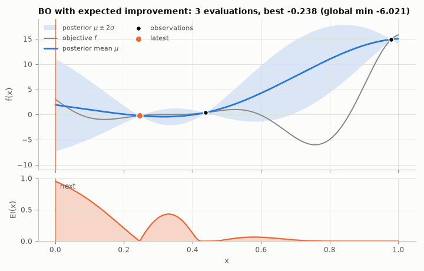
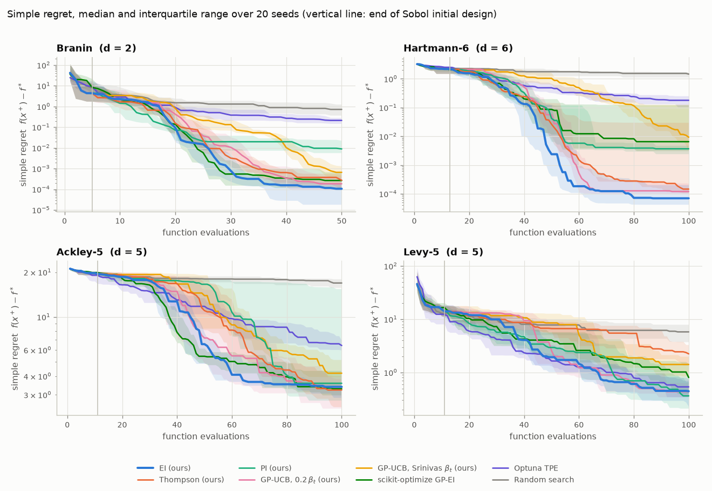
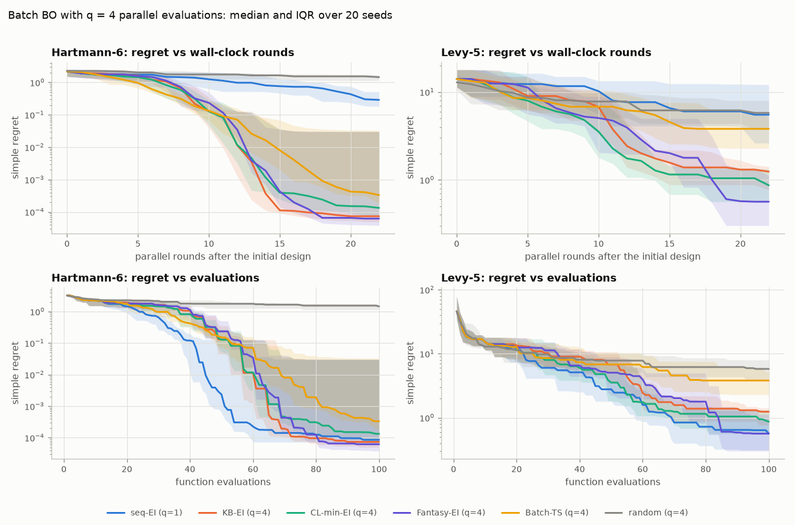
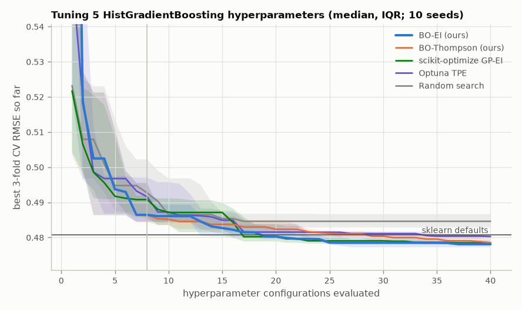
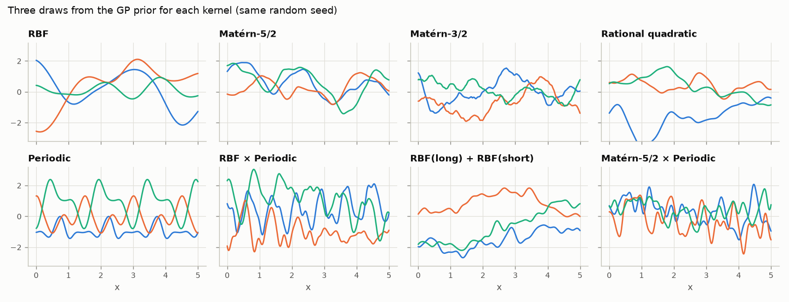
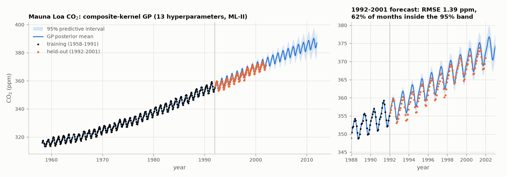
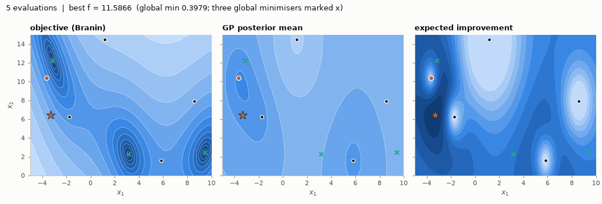

# bayesian-optimization-gp

Gaussian-process regression and Bayesian optimisation written from scratch in NumPy/SciPy: Cholesky-based GPs with analytic marginal-likelihood gradients, a kernel algebra, EI / PI / GP-UCB / Thompson-sampling acquisitions with analytic input gradients, and batch variants. Benchmarked against random search, scikit-optimize and Optuna TPE.

[](https://github.com/Jai-Advitheeya-Lella/bayesian-optimization-gp/actions/workflows/tests.yml)



This is a from-scratch reimplementation for learning and research. Everything in the `bogp` package is written against NumPy and SciPy's `cholesky`, `L-BFGS-B` and special functions; scikit-learn, scikit-optimize and Optuna are used **only** as reference implementations in the tests and as baselines in the benchmarks.

## Highlights

- **GP regression** with the Cholesky factorisation, ARD kernels (RBF, Matern-3/2, Matern-5/2, rational quadratic, periodic) and sum / product composition (`k1 + k2`, `k1 * k2`).
- **ML-II hyperparameter fitting** with analytic gradients of the log marginal likelihood w.r.t. every kernel and noise parameter (multi-start L-BFGS-B in log space).
- **Acquisitions** with analytic gradients w.r.t. the input `x`: EI (and a numerically stable log-EI), PI, GP-UCB with the Srinivas et al. `beta_t` schedule, and discretised Thompson sampling from joint posterior draws.
- **Batch BO** (`q` points per round): Kriging believer, constant liar, Monte-Carlo fantasies (Snoek et al. 2012) and batch Thompson sampling, scored with a Monte-Carlo q-EI.
- **Correctness tests (95)**: posterior mean, covariance and log marginal likelihood agree with scikit-learn's `GaussianProcessRegressor`; kernel, evidence, predictive and acquisition gradients agree with finite differences; EI / PI / q-EI agree with Monte-Carlo estimates.
- **Benchmarks** on Branin, Hartmann-6, Ackley-5 and Levy-5 over 20 seeds, plus a real hyperparameter-tuning task.

## Results

All experiments below were run on this machine (CPU only, no GPU is involved: the GP is a few hundred points at most; one BLAS thread per worker, 4 worker processes). Wall-clock times were measured on a machine that was shared with other jobs, so treat them as indicative.

### Benchmark functions: simple regret over 20 seeds



Final simple regret `f(x+) - f*` (median [interquartile range] over 20 seeds). Budgets: Branin 50, the others 100 evaluations; the initial design is `2d + 1` scrambled-Sobol points for every method. Mean wall-clock seconds per run in parentheses (a single run includes all GP fits and acquisition optimisation).

| Method | Branin | Hartmann-6 | Ackley-5 | Levy-5 |
|---|---|---|---|---|
| EI (ours) | 1.06e-04 [1.84e-05, 1.87e-04] (1.0s) | 6.98e-05 [4.26e-05, 2.04e-04] (4.4s) | 3.390 [2.873, 3.626] (4.3s) | 0.444 [0.226, 0.748] (5.0s) |
| Thompson (ours) | 2.73e-04 [9.18e-05, 5.40e-04] (8.1s) | 1.46e-04 [1.08e-04, 0.030] (19.2s) | 3.227 [2.489, 4.011] (17.5s) | 2.236 [1.373, 3.324] (18.9s) |
| PI (ours) | 8.89e-03 [5.77e-03, 0.023] (1.0s) | 3.69e-03 [2.46e-03, 4.79e-03] (4.2s) | 3.580 [2.750, 15.451] (4.3s) | 0.363 [0.212, 0.670] (4.6s) |
| GP-UCB, 0.2 beta_t (ours) | 1.84e-04 [9.33e-05, 4.19e-04] (1.0s) | 1.20e-04 [9.72e-05, 2.29e-04] (4.6s) | 3.371 [2.430, 3.844] (4.7s) | 0.435 [0.346, 0.639] (5.1s) |
| GP-UCB, Srinivas beta_t (ours) | 6.57e-04 [3.61e-04, 1.34e-03] (1.0s) | 9.32e-03 [3.01e-03, 0.128] (5.2s) | 4.186 [3.959, 5.160] (4.9s) | 1.412 [0.848, 1.995] (5.0s) |
| scikit-optimize GP-EI | 2.65e-04 [9.32e-05, 6.73e-04] (3.5s) | 6.51e-03 [3.14e-03, 0.124] (13.3s) | 3.289 [2.983, 4.356] (11.4s) | 0.803 [0.390, 1.455] (15.1s) |
| Optuna TPE | 0.212 [0.149, 0.289] (0.0s) | 0.179 [0.105, 0.254] (0.2s) | 6.426 [5.973, 6.915] (0.1s) | 0.536 [0.346, 0.705] (0.1s) |
| Random search | 0.722 [0.375, 1.275] (0.0s) | 1.460 [1.141, 1.674] (0.0s) | 16.912 [15.766, 18.002] (0.0s) | 5.786 [3.752, 7.977] (0.0s) |

What the numbers say, and what they do not:

- EI with an ARD Matern-5/2 GP is the strongest or tied-strongest method on Branin and Hartmann-6 (about two orders of magnitude lower regret than scikit-optimize on Hartmann-6), and PI / UCB (scaled) are competitive on the two harder problems. The well-behaved GP methods (EI, PI, scaled UCB, scikit-optimize) beat TPE and random search by a large margin on Branin, Hartmann-6 and Ackley-5; on Levy-5 the gap to TPE is small and TPE's median lies inside the interquartile range of EI.
- The theoretical GP-UCB schedule of Srinivas et al. (2010) over-explores at these budgets, as is well known; scaling `beta_t` by 0.2 is much better. Plain PI stalls near a regret of 1e-2 on Branin (it exploits too early).
- Thompson sampling here is discretised on 1,536 candidate points per iteration (1,024 Sobol + 512 local), which is a coarse approximation in 5-6 dimensions and is the weakest GP method on Levy-5. It is also ~4x slower per run because it needs joint posterior samples.
- **Ackley-5 is not solved by any method**: all GP-based methods end near a regret of 3 (random search: 17). The function is flat with exponentially many local minima away from the origin, and a stationary GP with 100 evaluations in a 5-D box of side 65 cannot locate the narrow global funnel. This is a limitation of the benchmark budget, not a bug that is hidden.

### Batch BO (q = 4 parallel evaluations)



Median simple regret over 20 seeds, 100 evaluations in total, 12 initial points. "Rounds" count sequential steps (one round = one evaluation for `q = 1`, four for `q = 4`).

| Method | Hartmann-6, after 10 rounds | Levy-5, after 10 rounds | Hartmann-6, after 100 evals | Levy-5, after 100 evals |
|---|---|---|---|---|
| seq-EI (q=1) | 1.255 | 10.233 | 8.61e-05 | 0.568 |
| KB-EI (q=4) | 0.128 | 6.765 | 7.38e-05 | 1.241 |
| CL-min-EI (q=4) | 0.128 | 3.543 | 1.34e-04 | 0.867 |
| Fantasy-EI (q=4) | 0.235 | 5.056 | 6.24e-05 | 0.564 |
| Batch-TS (q=4) | 0.134 | 6.808 | 3.34e-04 | 3.810 |
| random (q=4) | 1.767 | 7.803 | 1.460 | 5.786 |

Per round, `q = 4` batches are far ahead of sequential EI on Hartmann-6 (median regret 0.13 for Kriging believer and constant liar after 10 rounds, against 1.26 for sequential EI). Per evaluation the order flips: sequential EI is ahead of the batch variants for most of the run (bottom-left panel), as expected since every point sees all previous data, and all EI variants end at a similar regret of about 1e-4. On Levy-5 the differences between batch strategies are inside the seed-to-seed spread (see the IQR bands); only batch Thompson sampling is clearly worse.

### Real use case: tuning gradient-boosted trees

`HistGradientBoostingRegressor` (150 trees) on California housing, 10,000 training rows, objective = 3-fold CV RMSE, five hyperparameters (learning rate, leaves, min samples per leaf, L2, feature fraction), 40 evaluations, 10 seeds, 4 worker processes (621 s wall clock for all 50 runs). The test RMSE is measured on the 10,640 held-out rows for the configuration with the lowest CV RMSE.



| Method | best 3-fold CV RMSE | test RMSE of chosen config | seeds beating the default CV score | median evals to do so |
|---|---|---|---|---|
| Random search | 0.4852 ± 0.0046 | 0.4736 ± 0.0043 | 1/10 | 15 |
| Optuna TPE | 0.4800 ± 0.0006 | 0.4711 ± 0.0018 | 8/10 | 28 |
| scikit-optimize GP-EI | 0.4786 ± 0.0009 | 0.4702 ± 0.0023 | 10/10 | 17 |
| BO-Thompson (ours) | 0.4786 ± 0.0012 | 0.4710 ± 0.0015 | 9/10 | 29 |
| BO-EI (ours) | 0.4778 ± 0.0012 | 0.4702 ± 0.0014 | 10/10 | 18 |
| scikit-learn defaults (lr=0.1, 31 leaves) | 0.4807 | 0.4708 | - | - |

The scikit-learn defaults are already close to optimal on this problem, so the headroom is small: BO-EI improves the CV RMSE from 0.4807 to 0.4778 and beats the default in every seed, while random search over the same wide space beats it in only one of ten seeds. The held-out test RMSEs of all methods are within about one standard deviation of the defaults (0.4708), so the tuning gain does not clearly transfer to the test set.

### GP regression and kernels



The `RBF + (RBF x Periodic) + RationalQuadratic + RBF` composite kernel (13 hyperparameters: 12 kernel parameters and the noise variance; ML-II with 3 restarts) on the Mauna Loa CO2 series (training 1958-1991, 401 monthly means; forecast 1992-2001, 120 months), compared with scikit-learn's `GaussianProcessRegressor` using the same kernel structure:



| | log marginal likelihood | held-out RMSE (ppm) | fit time |
|---|---|---|---|
| bogp (ours) | 913.08 | 1.39 | 29.8 s |
| scikit-learn | 912.87 | 1.23 | 61.7 s |

Both reach essentially the same marginal likelihood. The 95% predictive intervals cover only 62% of the held-out months (ours): extrapolating a 34-year fit ten years ahead with ML-II point estimates under-states the uncertainty, and the log-likelihood surface of this kernel is multimodal, so the forecast error depends on which optimum the restarts land in (an earlier run of the same script on this machine reached a slightly lower likelihood of 912.24 but a held-out RMSE of 0.96 ppm and 82% coverage).



## How it works

**GP regression.** With kernel `k_theta`, noise `sigma_n^2` and `K = k(X, X) + sigma_n^2 I = L L^T`, the posterior at `x*` is `mu = k*^T alpha`, `var = k(x*, x*) - ||L^{-1} k*||^2` with `alpha = L^{-T} L^{-1} y`. The log evidence and its gradient are

$$\log p(y \mid X, \theta) = -\tfrac12 y^\top \alpha - \sum_i \log L_{ii} - \tfrac n2 \log 2\pi, \qquad \frac{\partial}{\partial \theta_j} = \tfrac12 \operatorname{tr}\!\Big[(\alpha\alpha^\top - K^{-1}) \frac{\partial K}{\partial \theta_j}\Big].$$

Targets are standardised and inputs are mapped to the unit cube inside the optimiser. Each kernel provides `dK/dtheta` in closed form; the tests compare all of them (and the input gradients `dk/dx`) with central finite differences.

**Acquisitions (minimisation).** With incumbent `f*` and `z = (f* - mu)/sigma`:

$$\mathrm{EI}(x) = \sigma(x)\,[z\,\Phi(z) + \varphi(z)], \quad \mathrm{PI}(x) = \Phi(z), \quad \mathrm{UCB}(x) = -\big(\mu(x) - \sqrt{\beta_t}\,\sigma(x)\big),$$

with `beta_t = 2 log(d t^2 pi^2 / (6 delta))` (Srinivas et al. 2010, Thm. 1). Gradients w.r.t. `x` use the analytic derivatives of `mu` and `sigma`, so the inner optimisation is multi-start L-BFGS-B started from the best of 1,536 raw candidates. Thompson sampling draws a joint posterior sample on a fresh Sobol-plus-local candidate set and returns its minimiser.

**Batches.** The `j`-th point of a batch maximises the acquisition of a model conditioned on fantasised outcomes for the first `j - 1` points: Kriging believer uses `y = mu(x)`, constant liar uses a fixed value, and Monte-Carlo fantasies average the acquisition over `M = 16` joint posterior samples of the pending outcomes.

## Quickstart

```bash
uv venv --python 3.12 .venv && source .venv/bin/activate
uv pip install -r requirements.txt && uv pip install -e .

pytest -q                                            # 95 tests, ~6 s

python scripts/make_animations.py --out assets       # the hero GIFs
python scripts/gp_regression_demo.py                 # kernel gallery + Mauna Loa CO2
python scripts/run_benchmarks.py --seeds 20 --workers 4   # ~14 min
python scripts/plot_results.py benchmarks
python scripts/run_batch.py --seeds 20 --workers 4        # ~6 min
python scripts/plot_results.py batch
python scripts/tune_hgb.py --seeds 10 --budget 40 --workers 4   # ~10 min, downloads the dataset
python scripts/plot_results.py hgb
```

Minimal use:

```python
import numpy as np
from bogp import BayesianOptimizer, get_benchmark

f = get_benchmark("branin")
opt = BayesianOptimizer(f.bounds, acquisition="ei", seed=0)    # "ei" | "pi" | "ucb" | "ts"
res = opt.minimize(f, n_evals=40)
print(res.y_best, res.x_best)

# ask / tell interface for expensive external objectives, q points at a time
opt = BayesianOptimizer(f.bounds, acquisition="ei", batch_size=4, batch_strategy="kb")
X = opt.ask(); opt.tell(X, f(X))
```

## Project structure

```
src/bogp/
  kernels.py       RBF, Matern-3/2, Matern-5/2, rational quadratic, periodic, sum/product; gradients
  gp.py            Cholesky GP, log evidence + gradient, ML-II fitting, posterior sampling, conditioning
  acquisition.py   EI, log-EI, PI, GP-UCB with input gradients
  optimize.py      Sobol design, multi-start L-BFGS-B acquisition maximiser, Thompson sampling
  batch.py         Kriging believer, constant liar, MC fantasies, batch TS, MC q-EI
  bo.py            BayesianOptimizer (ask / tell / minimize)
  benchmarks.py    Forrester, Branin, Hartmann-6, Ackley-d, Levy-d
  baselines.py     random search, scikit-optimize, Optuna TPE wrappers (baselines only)
tests/             kernels, GP vs scikit-learn, acquisitions vs Monte Carlo, end-to-end BO
scripts/           experiments, figures and animations (run from the repository root)
results/           raw benchmark arrays and the tables shown above
assets/            figures and GIFs
```

## References

- C. E. Rasmussen and C. K. I. Williams, *Gaussian Processes for Machine Learning*, MIT Press, 2006. [gaussianprocess.org/gpml](https://gaussianprocess.org/gpml/)
- J. Snoek, H. Larochelle, R. P. Adams, *Practical Bayesian Optimization of Machine Learning Algorithms*, NeurIPS 2012. [arXiv:1206.2944](https://arxiv.org/abs/1206.2944)
- N. Srinivas, A. Krause, S. Kakade, M. Seeger, *Gaussian Process Optimization in the Bandit Setting: No Regret and Experimental Design*, ICML 2010. [arXiv:0912.3995](https://arxiv.org/abs/0912.3995)
- P. I. Frazier, *A Tutorial on Bayesian Optimization*, 2018. [arXiv:1807.02811](https://arxiv.org/abs/1807.02811)
- D. R. Jones, M. Schonlau, W. J. Welch, *Efficient Global Optimization of Expensive Black-Box Functions*, J. Global Optimization, 1998.
- D. Ginsbourger, R. Le Riche, L. Carraro, *Kriging Is Well-Suited to Parallelize Optimization*, 2010.
- K. Kandasamy, A. Krishnamurthy, J. Schneider, B. Poczos, *Parallelised Bayesian Optimisation via Thompson Sampling*, AISTATS 2018.
- Test functions: S. Surjanovic and D. Bingham, Virtual Library of Simulation Experiments, [sfu.ca/~ssurjano](https://www.sfu.ca/~ssurjano/optimization.html).

Baselines: [scikit-optimize](https://scikit-optimize.github.io/) `gp_minimize`, [Optuna](https://optuna.org/) `TPESampler`.

## License

MIT, see [LICENSE](LICENSE).
